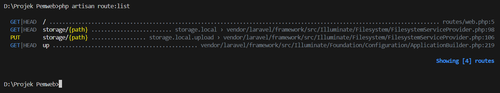

**Nama:Muhammad Syahid Ridho**

**NIM:10241051**


### 1. public/index.php
k Berkas `public/index.php` bertindak seperti pintu masuk utama yang memuat fungsi autoloader agar semua komponen Laravel saling terhubung.

### 2. bootstrap/app.php
```php
<?php

use Illuminate\Foundation\Application;
use Illuminate\Foundation\Configuration\Exceptions;
use Illuminate\Foundation\Configuration\Middleware;

return Application::configure(basePath: dirname(__DIR__))
    ->withRouting(
        web: __DIR__.'/../routes/web.php',
        commands: __DIR__.'/../routes/console.php',
        health: '/up',
    )
    ->withMiddleware(function (Middleware $middleware) {
        //
    })
    ->withExceptions(function (Exceptions $exceptions) {
        //
    })->create(); 
```
*   **Route:** Diurus oleh bagian fungsi `->withRouting(...)` yang bertugas mendaftarkan rute aplikasi.
*   **Middleware:** Diurus oleh bagian fungsi `->withMiddleware(...)` yang bertugas mengatur penyaring lalu lintas data atau pos penjagaan.
*   **Exception:** Diurus oleh bagian fungsi `->withExceptions(...)` yang bertugas menangani error jika terjadi masalah pada aplikasi.

### 3. routes/web.php
Route yang menghasilkan halaman selamat datang bawaan Laravel adalah `Route::get('/', function () { return view('welcome'); });`. Setelah saya mengubah bagian blok return tersebut menjadi teks buatan sendiri, saya memuat ulang browser dan melihat tampilannya langsung berubah sesuai dengan modifikasi yang saya buat.

Hasil:
 

### 4. php artisan route:list
Setelah menjalankan perintah `php artisan route:list`, keluaran di terminal menampilkan daftar rute yang aktif, salah satunya adalah rute dengan metode `GET` dan URI `/`. Hasil keluaran ini sangat cocok dengan apa yang tertulis dan didaftarkan secara manual di dalam berkas `routes/web.php`.

Hasil:
 


### 5. BREAK — Rusak dengan Sengaja

| # | Yang dirusak | Prediksi Anda sebelum mencoba | Pesan error sebenarnya |
|---|---|---|---|
| 1 | Ganti nama `.env` menjadi `.env.bak` | Website akan mati atau gagal memuat konfigurasi karena file utamanya hilang. | `500 Server Error` |
| 2 | Kosongkan nilai `APP_KEY` di `.env` | Aplikasi akan menolak berjalan demi keamanan karena kunci enkripsinya hilang. | `No application encryption key has been specified.` |
