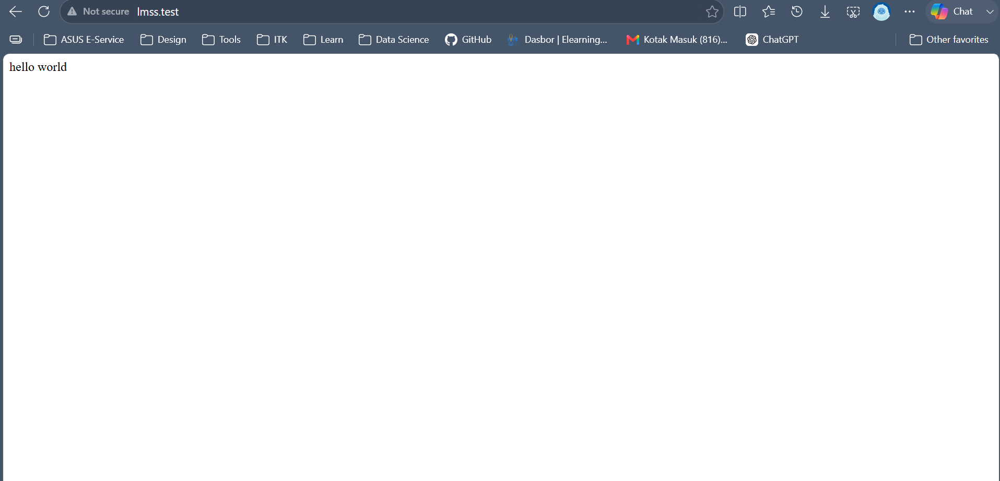
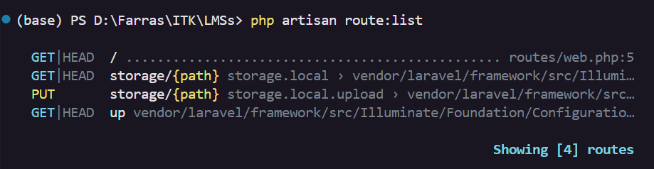

# Catatan Minggu 01

## 1. public/index.php

`public/index.php` mengecek apakah aplikasi sedang berada dalam kondisi maintenance. Kemudian, file ini memuat Composer dan aplikasi Laravel melalui `bootstrap/app.php`. Setelah itu, `public/index.php` menangkap request yang masuk dan memberikannya kepada aplikasi Laravel untuk diproses.

## 2. bootstrap/app.php

### Routing

Bagian routing terdapat pada `->withRouting()`. Pada bagian ini, route web diarahkan ke `routes/web.php`, sedangkan route untuk command diarahkan ke `routes/console.php` dan health check menggunakan `/up`.

### Middleware

Bagian middleware terdapat pada `->withMiddleware()`. Bagian ini digunakan untuk mengatur middleware aplikasi, tetapi pada instalasi saya belum terdapat konfigurasi tambahan di dalamnya.

### Exception

Bagian exception terdapat pada `->withExceptions()`. Bagian ini digunakan untuk mengatur penanganan exception atau error pada aplikasi, tetapi pada instalasi saya belum terdapat konfigurasi tambahan di dalamnya.

## 3. routes/web.php

Pada file `routes/web.php`, terdapat route dengan method `GET` dan URI `/` yang digunakan untuk menampilkan halaman awal aplikasi. Route tersebut mengarahkan request ke halaman `welcome`. Saya mengubah teks pada halaman Welcome, kemudian melakukan reload pada browser dan memastikan bahwa teks tersebut berhasil berubah.

Hasilnya:

## 4. `php artisan route:list`

Perintah `php artisan route:list`  digunakan untuk melihat daftar route yang tersedia di Laravel. Dari hasilnya, terdapat route / yang sesuai dengan route yang ada di `routes/web.php`.

Hasilnya:

