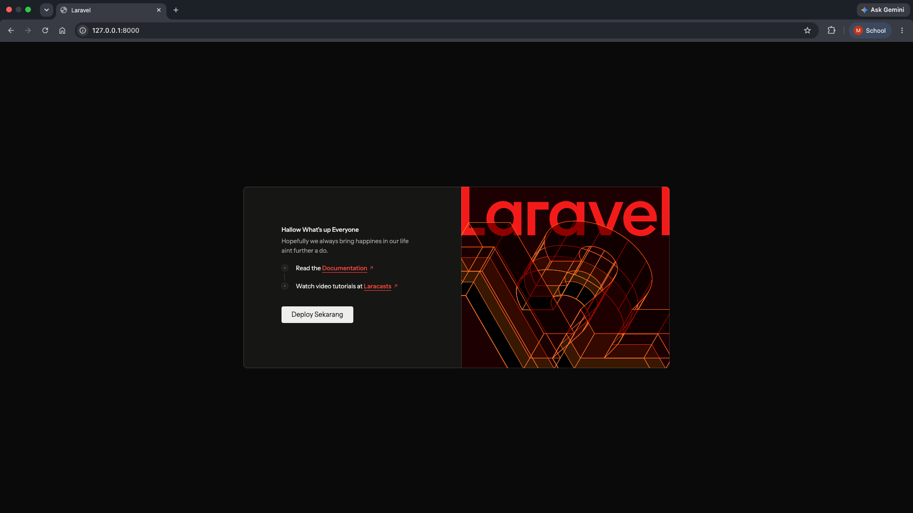
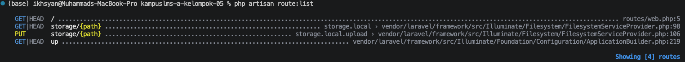
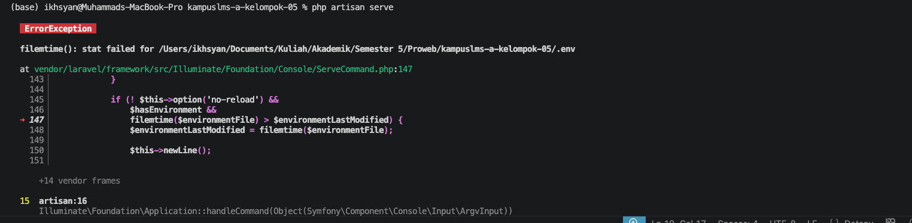
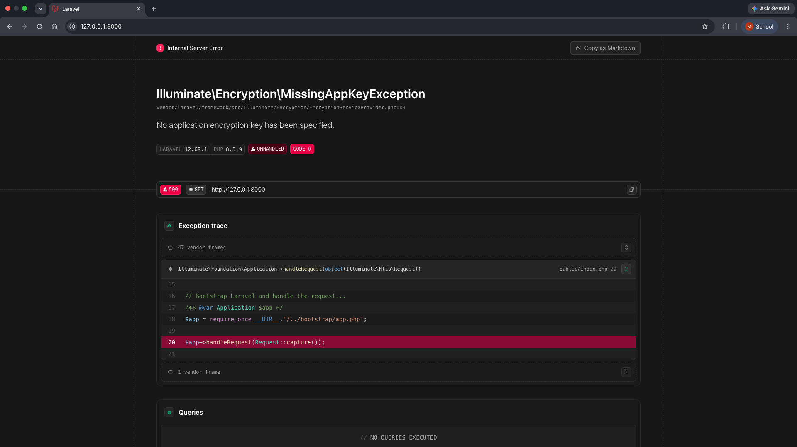
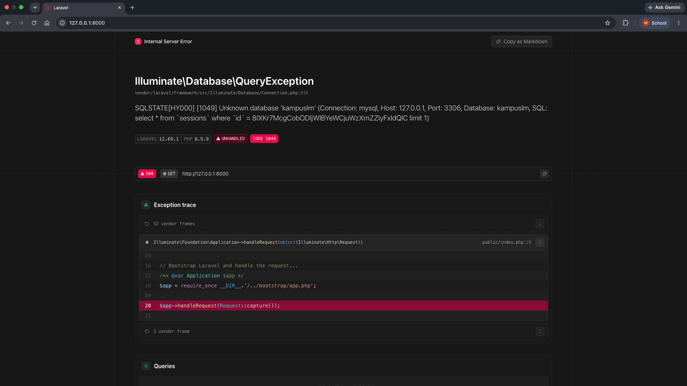
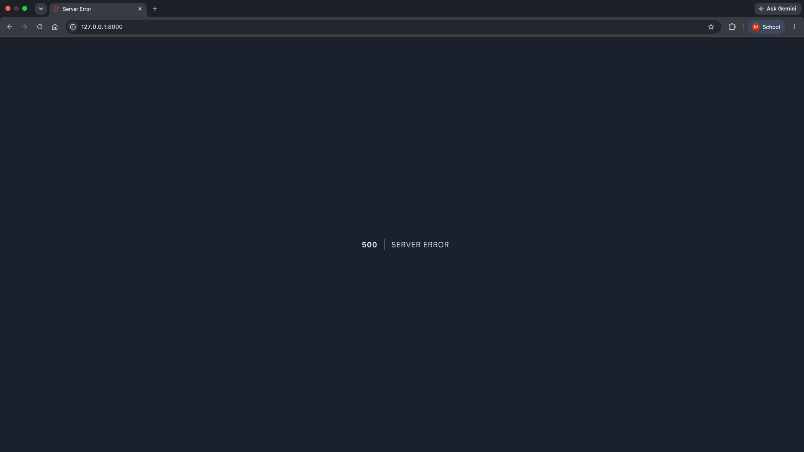

## Notes Minggu 1 Pemrograman Web

### READ

#### 1. Buka public/index.php. Baca dari atas ke bawah. Tulis dalam 3 kalimat apa yang dilakukan berkas ini.
Jawaban : <br>
File `index.php` adalah homepage untuk setiap request yang datang ke aplikasi Laravel lewat browser. File ini mengecek apakah aplikasi yang kita buat itu dalam mode _maintenance_, lalu menyalakan seluruh kode Laravel dan menyiapkan aplikasinya lewat `bootstrap/app.php`. Setelah itu, request yang masuk diserahkan ke Laravel untuk diproses, dan hasilnya (response) dikirim balik ke browser.

#### 2. Buka `bootstrap/app.php`. Identifikasi bagian mana yang mengurus route, mana yang mengurus middleware, mana yang mengurus exception.
Jawaban : <br>
Bagian yang mengurus route yaitu `withRouting()`, gunanya untuk menentukan file mana yang berisi daftar route aplikasi (misalnya `routes/web.php` untuk halaman web, `routes/console.php` untuk perintah artisan).
```php
->withRouting(
    web: __DIR__.'/../routes/web.php',
    commands: __DIR__.'/../routes/console.php',
    health: '/up',
)
```
Bagian yang mengurus middleware yaitu `withMiddleware()`, gunanya untuk mendaftarkan middleware, lapisan yang memeriksa request sebelum atau sesudah sampai ke controller.
```php
->withMiddleware(function (Middleware $middleware) {
    //
})
```
Bagian yang mengurus exception yaitu `withExceptions()`, gunanya untuk mengatur cara aplikasi menangani error.
```php
   ->withExceptions(function (Exceptions $exceptions) {
       //
   })
```

#### 3. Buka `routes/web.php`. Temukan route yang menghasilkan halaman selamat datang. Ubah teksnya, muat ulang browser, pastikan berubah.
Jawaban : <br>
Pada folder routes terdapat file `web.php` yang mengatur alur ketika pengguna mengakses website. Ketika pengguna membuka halaman utama, pengguna diarahkan ke halaman Welcome yang tampilannya diatur pada file `welcome.blade.php` di folder views. Untuk mengganti teksnya, saya mengubahnya langsung di file `welcome.blade.php`, dan setelah di refresh tampilannya berubah sesuai yang saya edit.

Sebelum di edit :


Sesudah di edit :


#### 4. Jalankan `php artisan route:list`. Cocokkan keluarannya dengan isi `routes/web.php`.
Jawaban : <br>
Hasil php artisan route:list menunjukkan,<br>
<br>
dan itu cocok persis dengan isi routes/web.php yang cuma punya satu route :
```php
Route::get('/', function () {
    return view('welcome');
});
```

### BREAK
#### Lakukan satu per satu, catat pesan errornya, lalu kembalikan:

| # | Yang dirusak | Prediksi Anda sebelum mencoba | Pesan error sebenarnya |
|---|--------------|-------------------------------|------------------------|
| 1 | Ganti nama `.env` menjadi `.env.bak` |Error sama sekali, karena gabisa nemuin nama persis `.env` | |
| 2 | Kosongkan nilai `APP_KEY` di `.env` |Error pada tampilan aplikasi dan data penting aplikasi telihat | |
| 3 | Ubah `DB_DATABASE` menjadi nama yang tidak ada | Tidak bisa menagkses data base dan muncul error karena tidak ada data base yang tersedia| |
| 4 | Ubah `APP_DEBUG=false`, lalu ulangi nomor 3 |tidak ada informasi error pada tampilan aplikasi | |

Artinya kalau mau informasinya tersembunyi harus `APP_DEBUG=false`?