## Notes Minggu 2 Pemrograman Web

### READ — Telusuri satu request penuh

#### 1. Baris mana di `routes/web.php` yang menangkap route `/tentang`?
Jawaban : <br>
Route `/tentang` ditangkap di `routes/web.php` pada baris ini:

```php
Route::get('/tentang', function () {
    return view('tentang');
});
```

Baris `Route::get('/tentang', ...)` artinya kalau browser minta halaman `/tentang` dengan method GET, Laravel menjalankan fungsi di dalamnya.

#### 2. Kalau ditangani controller, berkas dan method mana?
Jawaban : <br>
Route ini **belum** ditangani controller. Masih berupa _closure_ (fungsi anonim) yang ditulis langsung di `routes/web.php`, jadi tidak memanggil controller mana pun. Ini wajar di minggu 1, karena minggu 2 baru mulai memakai `CourseController`. Nanti bentuknya berubah jadi:

```php
Route::get('/tentang', [PageController::class, 'tentang']);
```

#### 3. View mana yang dikembalikan? Di path apa persisnya?
Jawaban : <br>
View yang dikembalikan adalah `tentang`, yang sebenarnya menunjuk ke berkas `resources/views/tentang.blade.php`. Laravel otomatis menambahkan folder `resources/views/` dan ekstensi `.blade.php`, jadi `view('tentang')` = `resources/views/tentang.blade.php`.

#### 4. Layout apa yang membungkusnya?
Jawaban : <br>
Saat ini **tidak ada** layout pembungkus. Berkas `tentang.blade.php` berdiri sendiri — isinya lengkap dari `<!DOCTYPE html>` sampai `</html>`. Belum memakai komponen `<x-layout>`. Ini juga yang nanti dirapikan di minggu 2, karena header/navbar seharusnya tidak disalin-tempel ke tiap halaman.

#### 5. Jalankan `php artisan route:list --path=tentang`. Cocokkan dengan analisis Anda?
Jawaban : <br>
Hasil `php artisan route:list --path=tentang`:

```text
GET|HEAD  tentang  ...
```

Keluarannya cocok dengan analisis: satu route `GET /tentang` yang mengembalikan view `tentang`, tanpa controller dan tanpa middleware.

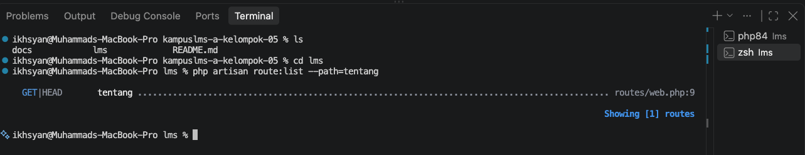

### BREAK — Delapan kerusakan

> Kolom **Prediksi** diisi sebelum mencoba. Kolom **Pesan error sebenarnya** diisi setelah menjalankan.

| # | Yang dirusak | Prediksi Anda sebelum mencoba | Pesan error sebenarnya |
|---|--------------|-------------------------------|------------------------|
| 1 | Ubah `Route::get` menjadi `Route::post` pada route daftar mata kuliah | Method HTTP tidak cocok. Browser buka `/courses` pakai GET, tapi route cuma terdaftar untuk POST, jadi muncul error 405 Method Not Allowed | 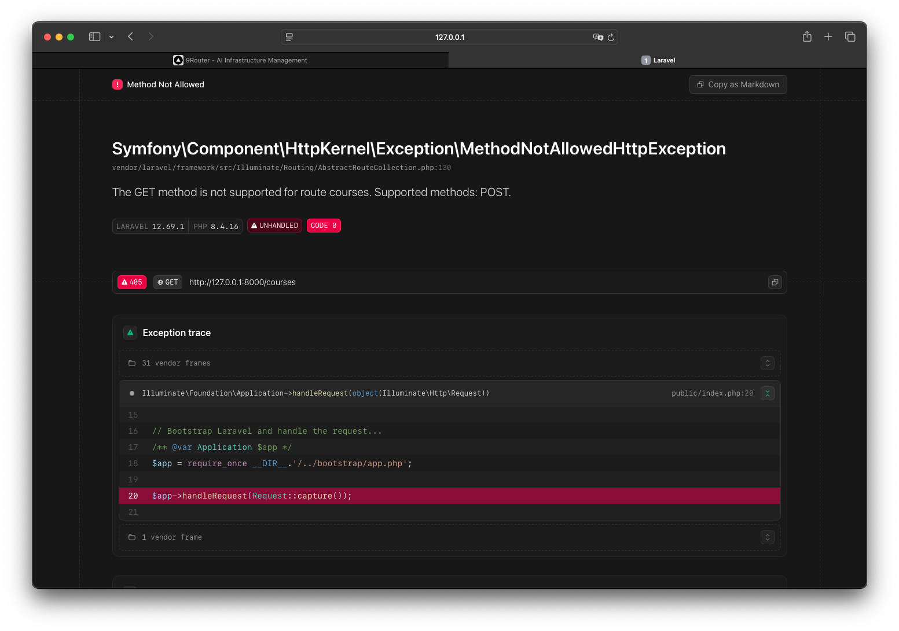
| 2 | Ubah nama view di `return view(...)` menjadi yang tidak ada | Muncul exception "View [xxx] not found" karena Laravel mencari berkas blade dengan nama itu di `resources/views/` dan tidak menemukannya | 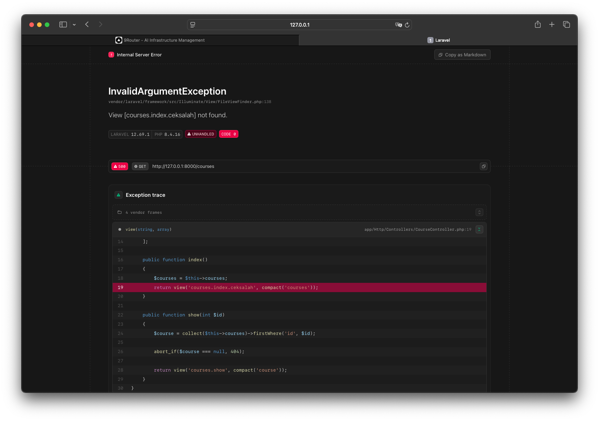 |
| 3 | Hapus `->name('courses.show')`, lalu muat halaman yang memakai `route('courses.show')` | Muncul error "Route [courses.show] not defined" karena helper `route()` mencari nama route yang sudah tidak terdaftar | 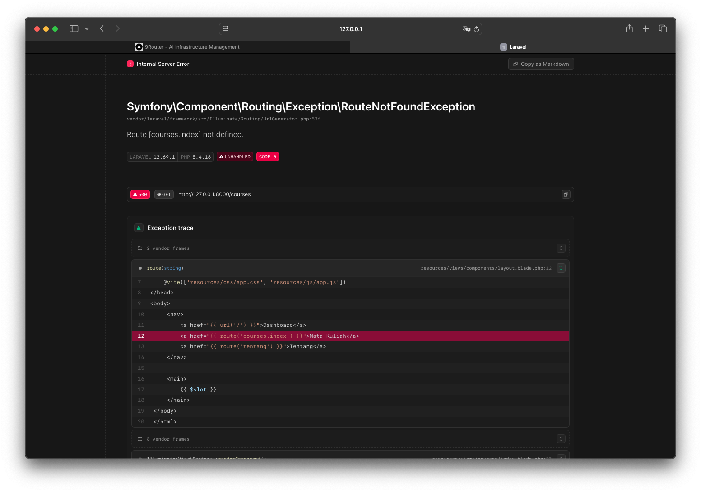 |
| 4 | Pindahkan `/courses/{course}` ke ATAS `/courses/create`, lalu buka `/courses/create` | `/courses/create` ditangkap sebagai parameter `{course}` dengan nilai "create", jadi malah mencari course bernama "create" (404) bukan form tambah | 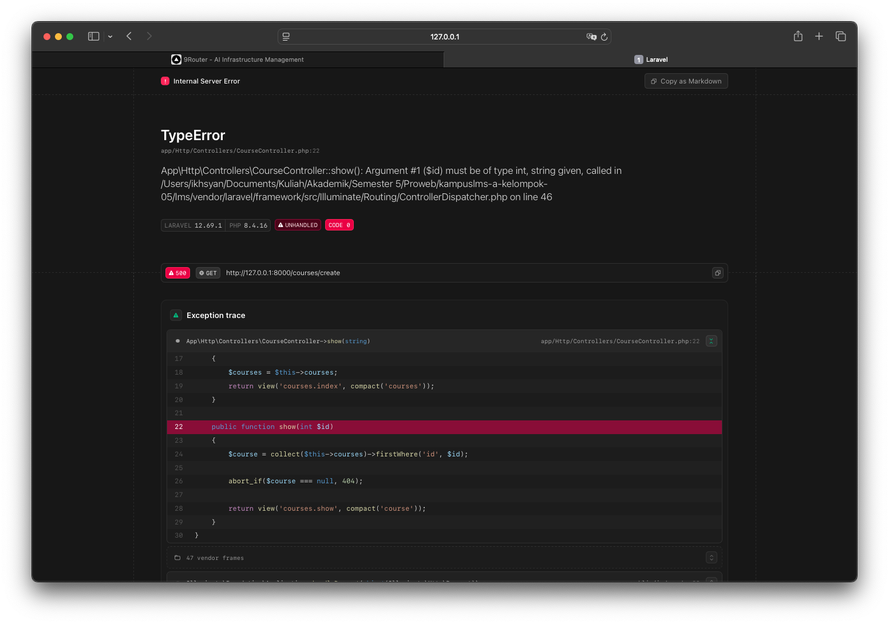 |
| 5 | Ganti `{{ $nama }}` menjadi `{!! $nama !!}`, isi `$nama` dengan `<script>alert('XSS')</script>` | Muncul popup alert "XSS" di browser. Script benar-benar dijalankan karena `{!! !!}` tidak menge-escape HTML | 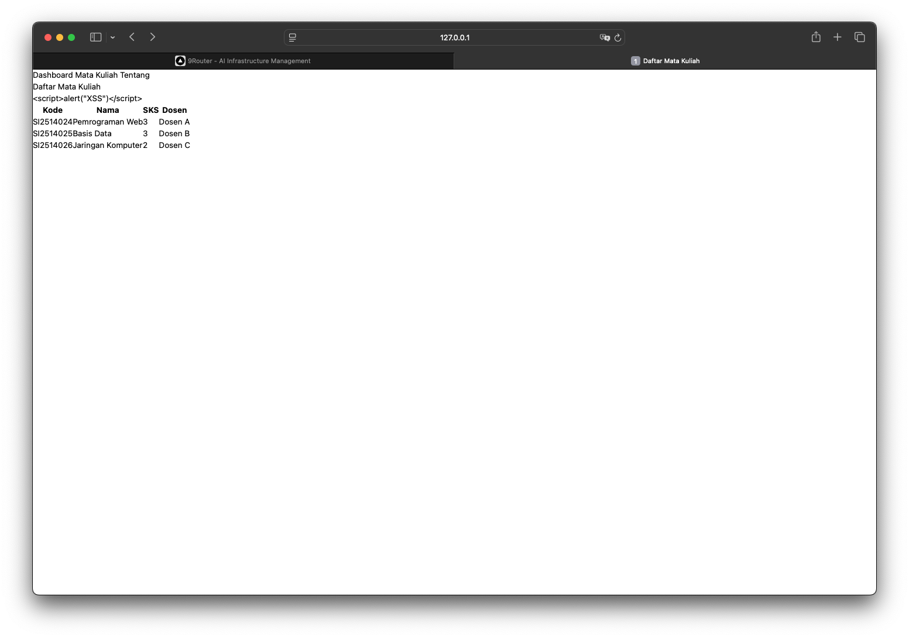 <!-- SS popup alert XSS -->
| 6 | Hapus `@vite(...)` dari layout | CSS/JS tidak termuat, halaman tampil polos tanpa style karena aset Vite tidak lagi dihubungkan | 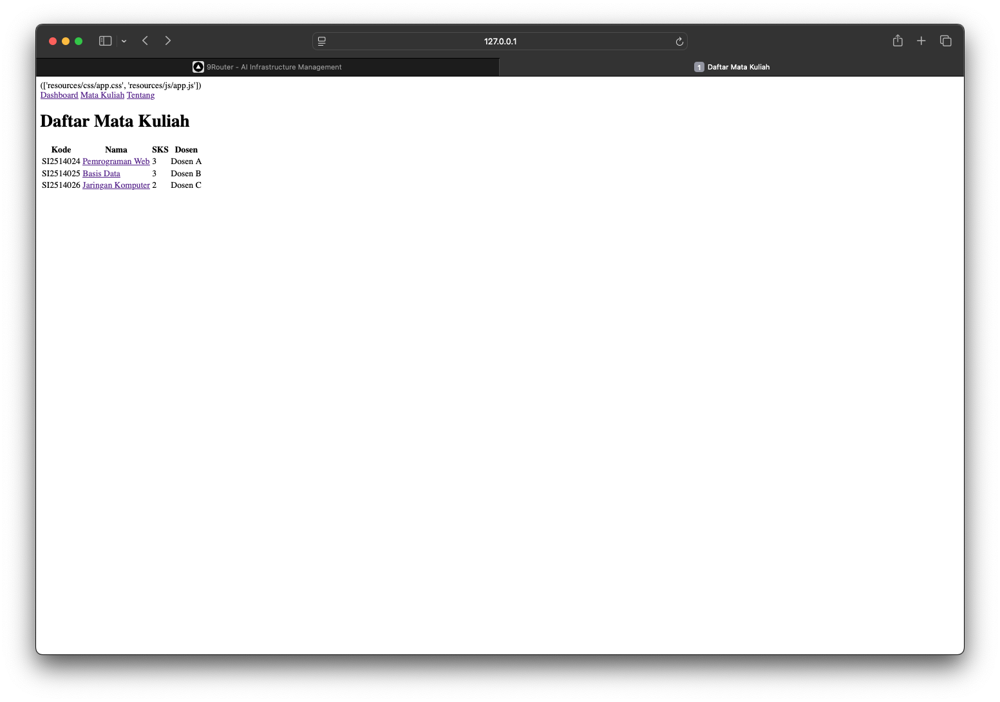 |
| 7 | Hentikan `npm run dev` lalu muat ulang halaman | Aset yang sebelumnya dilayani dev server jadi gagal dimuat (404 pada file CSS/JS) karena dev server mati | 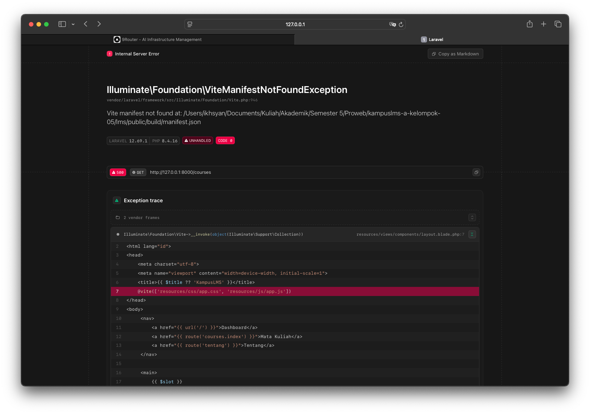 |
| 8 | Panggil `route('courses.show')` tanpa mengirim parameter | Muncul error "Missing required parameter for [Route: courses.show] [URI: courses/{course}]" karena parameter `{course}` wajib diisi | 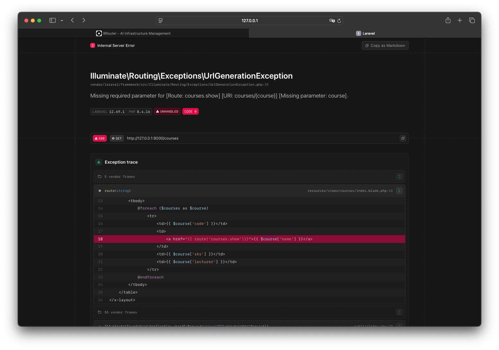 |

Catatan nomor 5: melihat `alert` muncul dari data yang "dimasukkan sebagai pengguna" mengubah cara kita memandang setiap keluaran di layar. Ini inti kenapa `{{ }}` (escape) wajib dipakai, dan `{!! !!}` nyaris tidak boleh.

### BUILD — Kerangka KampusLMS

Data masih statis (array di controller) — database baru minggu 3.

#### 1. Layout komponen `x-layout`
Berkas baru: `resources/views/components/layout.blade.php`

```blade
<!DOCTYPE html>
<html lang="id">
<head>
    <meta charset="utf-8">
    <meta name="viewport" content="width=device-width, initial-scale=1">
    <title>{{ $title ?? 'KampusLMS' }}</title>
    @vite(['resources/css/app.css', 'resources/js/app.js'])
</head>
<body>
    <nav>
        <a href="{{ url('/') }}">Dashboard</a>
        <a href="{{ route('courses.index') }}">Mata Kuliah</a>
        <a href="{{ route('tentang') }}">Tentang</a>
    </nav>

    <main>
        {{ $slot }}
    </main>
</body>
</html>
```

Kenapa begini: header dan navbar ditulis **sekali** di sini. Halaman lain tinggal bungkus pakai `<x-layout>`, tidak menyalin-tempel navbar. `{{ $slot }}` adalah tempat isi halaman ditaruh. `$title ?? 'KampusLMS'` memberi judul default kalau halaman tidak mengirim judul.

#### 2. `CourseController`
Berkas baru: `app/Http/Controllers/CourseController.php`

```php
<?php

namespace App\Http\Controllers;

class CourseController extends Controller
{
    // data statis sementara, database baru minggu 3
    private array $courses = [
        ['id' => 1, 'code' => 'SI2514024', 'name' => 'Pemrograman Web', 'sks' => 3, 'lecturer' => 'Dosen A'],
        ['id' => 2, 'code' => 'SI2514025', 'name' => 'Basis Data', 'sks' => 3, 'lecturer' => 'Dosen B'],
        ['id' => 3, 'code' => 'SI2514026', 'name' => 'Jaringan Komputer', 'sks' => 2, 'lecturer' => 'Dosen C'],
    ];

    public function index()
    {
        $courses = $this->courses;
        return view('courses.index', compact('courses'));
    }

    public function show(int $id)
    {
        $course = collect($this->courses)->firstWhere('id', $id);

        abort_if($course === null, 404);

        return view('courses.show', compact('course'));
    }
}
```

Controller tipis: `index` minta data lalu serahkan ke view, `show` cari satu mata kuliah lalu serahkan ke view. Kalau id tidak ditemukan, `abort(404)`.

#### 3. View daftar mata kuliah
Berkas baru: `resources/views/courses/index.blade.php`

```blade
<x-layout title="Daftar Mata Kuliah">
    <h1>Daftar Mata Kuliah</h1>

    <table>
        <thead>
            <tr>
                <th>Kode</th>
                <th>Nama</th>
                <th>SKS</th>
                <th>Dosen</th>
            </tr>
        </thead>
        <tbody>
            @foreach ($courses as $course)
                <tr>
                    <td>{{ $course['code'] }}</td>
                    <td>
                        <a href="{{ route('courses.show', $course['id']) }}">{{ $course['name'] }}</a>
                    </td>
                    <td>{{ $course['sks'] }}</td>
                    <td>{{ $course['lecturer'] }}</td>
                </tr>
            @endforeach
        </tbody>
    </table>
</x-layout>
```

Semua tautan memakai `route()` — tidak ada URL hardcode. Semua keluaran variabel memakai `{{ }}`.

#### 4. View detail mata kuliah
Berkas baru: `resources/views/courses/show.blade.php`

```blade
<x-layout title="{{ $course['name'] }}">
    <h1>{{ $course['name'] }}</h1>

    <p>Kode: {{ $course['code'] }}</p>
    <p>SKS: {{ $course['sks'] }}</p>
    <p>Dosen: {{ $course['lecturer'] }}</p>

    <a href="{{ route('courses.index') }}">Kembali ke daftar</a>
</x-layout>
```

#### 5. Route baru
`routes/web.php`:

```php
use App\Http\Controllers\CourseController;

Route::get('/tentang', function () {
    return view('tentang');
})->name('tentang');

Route::get('/courses', [CourseController::class, 'index'])->name('courses.index');
Route::get('/courses/{course}', [CourseController::class, 'show'])->name('courses.show');
```

`/courses` ditulis **sebelum** `/courses/{course}` supaya route dengan parameter tidak menutupi route tetap.

#### 6. Halaman 404 kustom
Berkas baru: `resources/views/errors/404.blade.php`

```blade
<x-layout title="Halaman Tidak Ditemukan">
    <h1>404</h1>
    <p>Halaman yang kamu cari tidak ditemukan.</p>
    <a href="{{ url('/') }}">Kembali ke beranda</a>
</x-layout>
```

#### Hasil `php artisan route:list`

```text
GET|HEAD  / .............
GET|HEAD  courses ............ courses.index › CourseController@index
GET|HEAD  courses/{course} ... courses.show › CourseController@show
GET|HEAD  tentang ............. tentang › routes/web.php:10
```

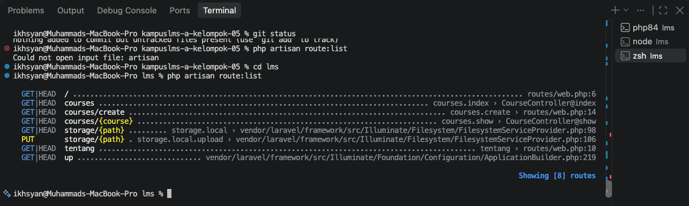 

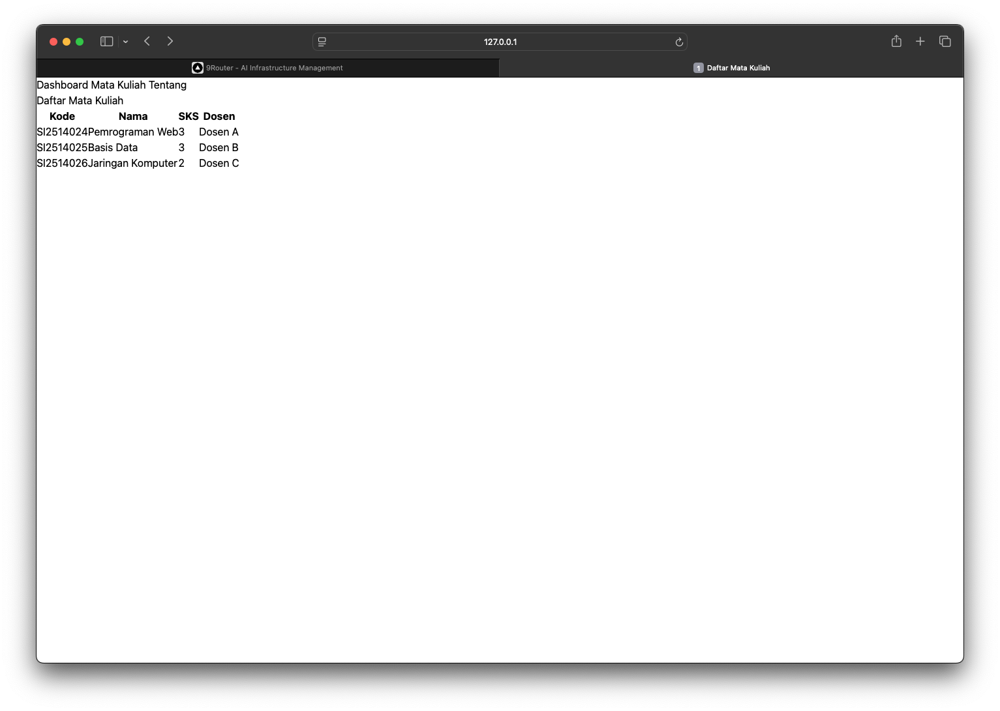 
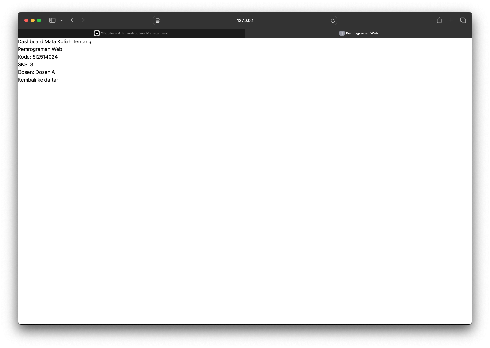 

#### Kendala
Saat pertama `npm run dev` muncul `vite: command not found` karena `node_modules` belum ada. Solusi: `npm install` dulu. Lalu `esbuild` perlu disetujui install script-nya (`npm install-scripts approve esbuild`), baru Vite jalan.


