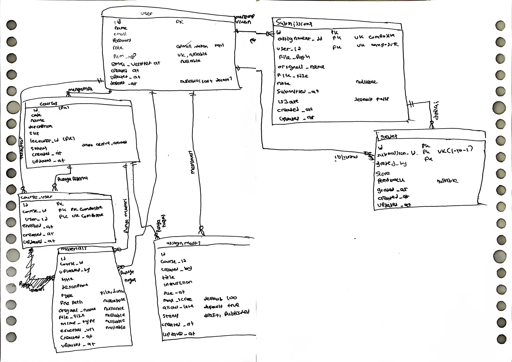

## Notes Minggu 3 Pemrograman Web

### READ — Baca skema sebelum menulisnya

#### 1. Gambar ulang ERD dari spesifikasi



Tabel inti ada 7: `users`, `courses`, `course_user` (pivot), `materials`, `assignments`, `submissions`, `grades`. Ditambah `notifications` bawaan Laravel.

#### 2. Untuk setiap foreign key, tentukan perilaku `onDelete` dan alasannya

**Tabel `courses`**

| FK | Kode migrasi | onDelete | Alasan |
|---|---|---|---|
| `lecturer_id` | `->constrained('users')->restrictOnDelete()` | RESTRICT | Dosen yang masih mengampu MK tidak boleh dihapus. Admin harus pindahkan pengampu dulu. Kalau pakai cascade, hapus dosen = hapus semua MK-nya + seluruh data di bawahnya. |

**Tabel `course_user`**

| FK | Kode migrasi | onDelete | Alasan |
|---|---|---|---|
| `course_id` | `->constrained('courses')->cascadeOnDelete()` | CASCADE | MK dihapus → enrollment sudah tidak relevan, ikut hilang. |
| `user_id` | `->constrained('users')->cascadeOnDelete()` | CASCADE | Mahasiswa dihapus → data pendaftarannya ikut hilang. |

**Tabel `materials`**

| FK | Kode migrasi | onDelete | Alasan |
|---|---|---|---|
| `course_id` | `->constrained('courses')->cascadeOnDelete()` | CASCADE | MK dihapus → materinya tidak berguna lagi, ikut hilang. |
| `uploaded_by` | `->constrained('users')` | RESTRICT (default) | Dosen yang sudah upload materi tidak boleh dihapus selama materinya masih ada. Menjaga riwayat siapa yang mengunggah. |

**Tabel `assignments`**

| FK | Kode migrasi | onDelete | Alasan |
|---|---|---|---|
| `course_id` | `->constrained('courses')->cascadeOnDelete()` | CASCADE | MK dihapus → tugasnya ikut hilang. |
| `created_by` | `->constrained('users')` | RESTRICT (default) | Dosen pembuat tugas tidak boleh dihapus selama tugasnya masih ada. Menjaga jejak siapa yang buat tugas. |

**Tabel `submissions`**

| FK | Kode migrasi | onDelete | Alasan |
|---|---|---|---|
| `assignment_id` | `->constrained('assignments')->cascadeOnDelete()` | CASCADE | Tugas dihapus → pengumpulan tidak bermakna lagi, ikut hilang. |
| `user_id` | `->constrained('users')->cascadeOnDelete()` | CASCADE | Mahasiswa dihapus → riwayat pengumpulannya ikut hilang. |

**Tabel `grades`**

| FK | Kode migrasi | onDelete | Alasan |
|---|---|---|---|
| `submission_id` | `->unique()->constrained('submissions')->cascadeOnDelete()` | CASCADE | Submission dihapus → nilainya ikut hilang. Nilai tanpa submission tidak punya arti. |
| `graded_by` | `->constrained('users')` | RESTRICT (default) | Dosen penilai tidak boleh dihapus selama data penilaiannya masih ada. Menjaga jejak audit siapa yang menilai. |

**Pola:**
- **CASCADE** → data anak mutlak bergantung pada induk dan tidak bisa berdiri sendiri (materi, tugas, enrollment, submission, grade).
- **RESTRICT** → melindungi riwayat dan mencegah penghapusan yang berbahaya (dosen pengampu, dosen yang upload, dosen yang buat tugas, dosen yang menilai).

#### 3. Kalau seorang dosen dihapus, apa yang terjadi pada mata kuliahnya? Kenapa dirancang begitu?

Jawaban : <br>
Penghapusan **ditolak (error)** oleh database. Kode migrasinya:

```php
$table->foreignId('lecturer_id')
    ->constrained('users')
    ->restrictOnDelete();
```

Kenapa begitu: kalau `lecturer_id` pakai `cascadeOnDelete`, menghapus satu dosen akan menghapus **semua MK yang dia ampu**, lalu karena `materials`, `assignments`, `submissions`, dan `grades` semuanya cascade terhadap `course_id` → **seluruh materi, tugas, pengumpulan, dan nilai mahasiswa** di MK itu hilang berantai. Ini bencana data.

`restrictOnDelete` memaksa admin untuk mengganti pengampu dulu ke dosen lain sebelum bisa menghapus data dosen.

Catatan tambahan: model `User` memakai `SoftDeletes`, jadi praktiknya dosen tidak benar-benar dihapus dari tabel — hanya ditandai `deleted_at`. Dan relasi `Course->lecturer()` memakai `->withTrashed()` supaya nama dosen tetap bisa ditampilkan meskipun sudah di-soft-delete.

#### 4. Kenapa `grades.submission_id` bersifat unique, bukan sekadar index biasa?

Jawaban : <br>
`unique()` menegakkan **relasi 1-to-1** di level database: satu submission hanya boleh punya tepat satu grade. Kode migrasinya:

```php
$table->foreignId('submission_id')
    ->unique()
    ->constrained('submissions')
    ->cascadeOnDelete();
```

Di model `Submission` juga dideklarasikan `HasOne` (bukan `HasMany`):

```php
public function grade(): HasOne
{
    return $this->hasOne(Grade::class);
}
```

Index biasa (`->index()`) hanya mempercepat pencarian, tidak mencegah duplikasi. Tanpa `unique()`, kalau dosen klik "Simpan Nilai" dua kali cepat (race condition) atau ada bug di kode, bisa muncul dua baris grade untuk satu submission — misal skor 80 dan skor 90. Validasi di controller bisa dilewati oleh race condition, tapi constraint `unique` di database **tidak bisa ditipu**.

---

### BREAK — Lima kerusakan

> Kolom **Prediksi** diisi sebelum mencoba. Kolom **Yang terjadi** diisi setelah menjalankan.

| # | Yang dicoba | Prediksi | Yang terjadi |
|---|-------------|----------|--------------|
| 1 | Hapus `unique(['course_id','user_id'])` dari migrasi `course_user`, lalu daftarkan mahasiswa yang sama dua kali ke satu MK | Data enrollment ganda akan lolos tanpa keluhan dari database | Benar — `course_user` menerima baris duplikat. Di halaman daftar mahasiswa per MK, nama yang sama muncul dua kali. Hitungan `count()` enrollment jadi salah. Unique composite di level database adalah jaminan integritas data bisnis; pengecekan di controller saja tidak cukup karena bisa dilewati race condition. |
| 2 | Tambahkan `role` ke `$fillable` model User, lalu kirim request pembuatan user dengan `role=admin` lewat Tinker (padahal form di frontend tidak punya field role) | Siapa pun bisa jadi admin karena `role` sekarang bisa diisi dari input — mass assignment terbuka | Benar — jalankan di Tinker: `User::create(['name'=>'Penyusup', 'email'=>'x@x.test', 'password'=>'rahasia', 'role'=>'admin'])`. Cek: `User::where('email','x@x.test')->value('role')` hasilnya `'admin'`. Formulir di frontend **bukan pembatas apa pun**. Kolom sensitif seperti `role` tidak boleh masuk `$fillable` — harus diisi eksplisit di controller. |
| 3 | Ganti seluruh `$fillable` dengan `protected $guarded = []` lalu ulangi nomor 2 | Lebih parah — **semua** kolom jadi bisa diisi dari input pengguna, termasuk `id`, `email_verified_at`, `deleted_at` | Benar — tidak ada kolom yang dilindungi. Penyerang bisa mengatur `email_verified_at`, menentukan `id` sendiri, bahkan mengeset `deleted_at`. `$guarded = []` artinya "tidak ada yang dijaga" — mematikan seluruh perlindungan mass assignment. Dilarang keras. |
| 4 | Kosongkan isi `down()` di satu migrasi, lalu jalankan `php artisan migrate:refresh` | `migrate:refresh` akan gagal karena `down()` kosong tidak menghapus tabel, lalu `up()` mencoba membuat tabel yang sudah ada | Benar — error "table already exists". `down()` wajib benar-benar membalik `up()`. Migrasi yang `down()`-nya rusak = CI merah saat jalankan `migrate:refresh`. |
| 5 | Ubah `restrictOnDelete` pada `lecturer_id` menjadi `cascadeOnDelete`, lalu hapus satu dosen | Hapus 1 dosen akan menghapus semua MK-nya, dan karena cascade berantai, semua materi, tugas, submission, dan grade ikut hilang | Benar — kehilangan data berantai massal. Hapus 1 dosen → hapus MK → hapus enrollment + materi + tugas → hapus submission → hapus grade. Satu baris `cascadeOnDelete` yang salah bisa menghancurkan seluruh data akademik. |

Catatan nomor 2: wajib benar-benar dicoba, bukan dibayangkan. Perlu melihat sendiri bahwa **formulir di frontend bukan pembatas apa pun** — siapa pun bisa mengirim field tambahan lewat `curl`, Postman, atau DevTools.

---

### Rangkuman Kesesuaian dengan Spesifikasi

#### Constraint & Index (Bagian 4.2)

| Tabel | Ketentuan | Status |
|---|---|---|
| `users` | `email` unique, `nim_nip` unique nullable, index pada `role` | Sudah ada |
| `courses` | `code` unique, FK `lecturer_id` → `restrictOnDelete` | Sudah ada |
| `course_user` | unique composite `[course_id, user_id]` | Sudah ada |
| `materials` | FK `course_id` `cascadeOnDelete`, index `course_id` | Sudah ada |
| `assignments` | FK `course_id` `cascadeOnDelete`, index `[course_id, due_at]` | Sudah ada |
| `submissions` | unique composite `[assignment_id, user_id]` | Sudah ada |
| `grades` | `submission_id` unique (1-to-1) | Sudah ada |

#### Relasi Eloquent (Bagian 4.3)

| Model | Method | Tipe | Status |
|---|---|---|---|
| User | `taughtCourses()` | `hasMany(Course, 'lecturer_id')` | Sudah ada |
| User | `courses()` | `belongsToMany(Course)->withPivot('enrolled_at')->withTimestamps()` | Sudah ada |
| User | `submissions()` | `hasMany(Submission)` | Sudah ada |
| User | `gradesGiven()` | `hasMany(Grade, 'graded_by')` | Sudah ada |
| Course | `lecturer()` | `belongsTo(User, 'lecturer_id')->withTrashed()` | Sudah ada |
| Course | `students()` | `belongsToMany(User)->withPivot('enrolled_at')->withTimestamps()` | Sudah ada |
| Course | `materials()` | `hasMany(Material)` | Sudah ada |
| Course | `assignments()` | `hasMany(Assignment)` | Sudah ada |
| Assignment | `course()` | `belongsTo(Course)` | Sudah ada |
| Assignment | `submissions()` | `hasMany(Submission)` | Sudah ada |
| Assignment | `grades()` | `hasManyThrough(Grade, Submission)` | Sudah ada |
| Submission | `assignment()` | `belongsTo(Assignment)` | Sudah ada |
| Submission | `student()` | `belongsTo(User, 'user_id')` | Sudah ada |
| Submission | `grade()` | `hasOne(Grade)` | Sudah ada |
| Grade | `submission()` | `belongsTo(Submission)` | Sudah ada |
| Grade | `grader()` | `belongsTo(User, 'graded_by')` | Sudah ada |

#### Mass Assignment Protection

| Model | `$fillable` | Kolom sensitif di luar `$fillable` | Cara diisi |
|---|---|---|---|
| User | `name, email, password, nim_nip` | `role` | Eksplisit di controller |
| Course | `code, name, description, sks, status` | `lecturer_id` | Eksplisit di controller |
| Material | `title, description, type, external_url` | `course_id, uploaded_by, file_path, original_name, file_size, mime_type` | Eksplisit (upload handling) |
| Assignment | `title, instructions, due_at, max_score, allow_late` | `course_id, created_by, status` | Eksplisit di controller |
| Submission | `note` | `assignment_id, user_id, file_path, original_name, file_size, submitted_at, is_late` | Eksplisit (upload handling) |
| Grade | `score, feedback` | `submission_id, graded_by, graded_at` | Eksplisit di controller |
