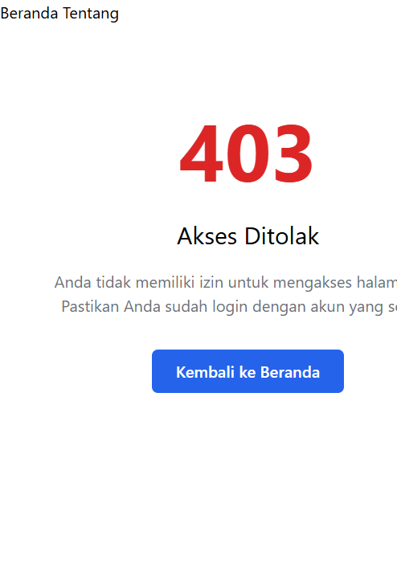

# Catatan Minggu 5 — Yusuf

## Fokus

Menutup akses IDOR pada detail mata kuliah dan materi, memakai implicit route model binding, serta menyediakan halaman 403 yang tidak membocorkan kepemilikan data.

## Daftar titik rawan IDOR

| Route                            | Parameter            | Risiko                                                            | Pengaman                                                                             | Hasil                                               |
| -------------------------------- | -------------------- | ----------------------------------------------------------------- | ------------------------------------------------------------------------------------ | --------------------------------------------------- |
| `dosen/courses/{course}`         | `Course $course`     | Dosen mengganti ID dan membaca mata kuliah dosen lain             | Middleware `role:dosen` dan pemeriksaan `lecturer_id` di `CourseController::show()`  | Dosen pengampu diizinkan; dosen lain mendapat 403   |
| `mahasiswa/courses/{course}`     | `Course $course`     | Mahasiswa mengganti ID dan membaca mata kuliah yang tidak diikuti | Middleware `role:mahasiswa` dan pemeriksaan enrollment di `CourseController::show()` | Mahasiswa terdaftar diizinkan; lainnya mendapat 403 |
| `admin/materials/{material}`     | `Material $material` | Parameter ID material dimanipulasi                                | Middleware `role:admin`, implicit binding, pemeriksaan role controller               | Admin diizinkan                                     |
| `dosen/materials/{material}`     | `Material $material` | Dosen membaca materi course dosen lain                            | Middleware `role:dosen` dan `abort_unless` terhadap `course.lecturer_id`             | Hanya dosen pengampu diizinkan                      |
| `mahasiswa/materials/{material}` | `Material $material` | Mahasiswa membaca materi course yang tidak diikuti                | Middleware `role:mahasiswa` dan `abort_unless` terhadap relasi enrollment            | Hanya mahasiswa terdaftar diizinkan                 |

Route model binding mencari record berdasarkan route key, tetapi tidak dengan sendirinya memastikan pengguna berhak melihat record itu. Karena itu, controller tetap memeriksa kepemilikan atau enrollment setelah binding.

## Perubahan implementasi

- `MaterialController::show(Material $material)` menggunakan implicit route model binding.
- Rute detail material didaftarkan sebagai nested resource `courses.materials`, hanya aksi `show`, dengan `scopeBindings()` dan `shallow()` di grup admin, dosen, dan mahasiswa.
- `CourseController::show(Course $course)` pada `main` sudah memakai route model binding dan `abort_unless` untuk memeriksa dosen pengampu atau enrollment mahasiswa. Tidak ada lagi pencarian manual `findOrFail($id)` pada alur detail course.
- `resources/views/errors/403.blade.php` dari `main` digunakan kembali. Halaman menampilkan pesan umum dan tidak mengungkap pemilik atau keberadaan data yang diminta.
- `resources/views/materials/show.blade.php` menampilkan detail materi setelah otorisasi lolos.

## BREAK #2 dan #3: nested binding

Untuk mengisolasi perilaku Laravel, `WeekFiveIdorTest` mendaftarkan dua route uji dengan bentuk nested yang sama:

```text
/_test-unscoped/courses/{course}/assignments/{assignment}
/_test-scoped/courses/{course}/assignments/{assignment}
```

Fixture membuat course A dan assignment yang sebenarnya dimiliki course B.

| Percobaan                | Hasil                                                | Arti                                                                                                             |
| ------------------------ | ---------------------------------------------------- | ---------------------------------------------------------------------------------------------------------------- |
| Tanpa `scopeBindings()`  | HTTP 200; assignment ditemukan berdasarkan ID global | Route dapat menerima child dari parent yang berbeda jika tidak ada pemeriksaan lain                              |
| Dengan `scopeBindings()` | HTTP 404                                             | Laravel mencari assignment melalui relasi `course.assignments`; child yang tidak dimiliki parent tidak ditemukan |

**Catatan kesesuaian URL:** URL contoh modul `/courses/1/assignments/99` tidak terdaftar persis pada aplikasi Week 5 saat ini. Route dosen yang aktif memakai prefix `/dosen` dan `->shallow()`, sehingga detail assignment menjadi `/dosen/assignments/{assignment}` tanpa `{course}` pada URL. Karena parent tidak ada pada URL shallow untuk aksi `show`, `scopeBindings()` tidak dapat membandingkan parent-child pada aksi tersebut. Karena itu, otorisasi detail assignment tetap harus dilakukan di controller. Perbandingan #2/#3 di atas dilakukan melalui route uji nested eksplisit.

## Pengujian

Jalankan dari direktori `lms`:

```powershell
php artisan test --filter=WeekFiveIdorTest
```

Cakupan test:

- Admin dapat melihat materi.
- Dosen dapat melihat materi course yang dia ampu dan ditolak untuk course dosen lain.
- Mahasiswa dapat melihat materi course yang diikuti dan ditolak untuk course lain.
- Dosen yang bukan pengampu ditolak saat membuka detail course.
- Nested route tanpa scope menerima assignment lintas course; route dengan scope menolak child tersebut dengan 404.
- Penolakan akses menampilkan halaman 403 kustom dan tidak membocorkan nama pemilik/course yang ditolak.

Hasil saat implementasi: **5 test lulus, 17 assertion**.

## Bukti halaman 403

Halaman 403 diuji melalui feature test dengan `assertForbidden()` dan pemeriksaan teks halaman. Screenshot halaman kustom:



Screenshot menampilkan pesan akses ditolak yang umum tanpa informasi tentang pemilik atau data yang diminta.
